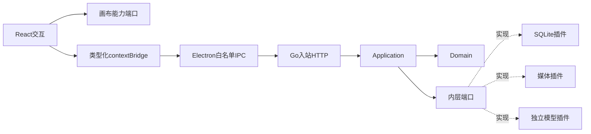

# 墨华画布架构

全新的本机 Electron 应用：Go 是受桌面会话鉴权的 sidecar，React 持有活动画布。没有账号、租户、积分、公共工作区、旧数据迁移或旧接口兼容。

| 目录 | 职责与依赖 |
| --- | --- |
| internal/domain | 业务模型及不变量；仅标准库，无I/O |
| internal/application | 项目、渠道、任务、素材、创作库用例；仅Domain和消费者端口 |
| internal/application/ports | 持久化、凭据、媒体、模型契约；无SQL/供应商类型 |
| internal/adapters/inbound/http | 独立DTO、映射、鉴权、错误；不实现业务规则 |
| internal/adapters/outbound | 端口实现；适配器之间互不导入 |
| internal/platform/httpclient | 适配器复用的无业务状态HTTP/JSON与受限下载助手；不依赖Application或具体适配器 |
| internal/bootstrap、cmd/mohua | 唯一组合根；清单校验、构造、注入、逆序关闭 |
| electron/main | 窗口、来源校验、sidecar、主密钥、HTTP网关和媒体协议；无业务规则 |
| electron/preload | 固定IPC方法；无Node/原始ipcRenderer/通用URL转发 |
| renderer/features/canvas | 活动文档、节点/连线命令、视口、撤销；实时状态权威 |
| renderer/features/agent | 对话、候选命令确认；只调用画布能力 |
| renderer/services | 类型化桌面客户端；无供应商或持久化逻辑 |

React使用Vite和React Flow。实例由组合根注入，禁止包级服务单例。节点插件只贡献类型、标签和呈现。

| 数据 | 权威所有者 / 生命周期 |
| --- | --- |
| 活动文档 | renderer；显式保存快照，选中/撤销栈不保存 |
| 项目快照与revision | Go；SQLite CAS，显式删除 |
| 渠道/任务/创作库 | Go；SQLite，重启中断未完成任务，不重复有成本调用 |
| API Key | Go凭据端口；AES-GCM，Electron safeStorage保护主密钥；配置输入短暂经过UI/IPC，不留日志或普通存储 |
| 媒体 | Go；文件+元信息，拒绝删除被引用素材 |
| Agent对话/候选命令 | renderer会话内存，切换项目重置 |

数据目录是Electron userData/workspace-v1，不读取旧数据库/IndexedDB/WebDAV。契约从v1开始，不支持版本明确拒绝。

主进程取得单实例锁，生成随机会话token，初始化/解密主密钥，启动Go；Go仅监听127.0.0.1:0。带token健康检查完成后打开窗口。token/主密钥经环境传Go，不进入renderer、URL或日志。媒体经mohua-media://asset/<UUID>，主进程附加凭据访问私有HTTP。

窗口sandbox/contextIsolation开启、nodeIntegration关闭，禁止导航和新窗口。IPC校验主窗口/主frame/应用URL及操作字段，Go独立权威校验。退出关闭stdin，再终止逾期sidecar；Go取消任务、关闭HTTP和插件。异常退出明确报错。

插件是受信编译期端口实现/节点贡献，不加载任意磁盘代码，不实现市场、热卸载、OSS或外部MCP。新增渠道只改插件和组合根。具体契约见docs/contracts。
